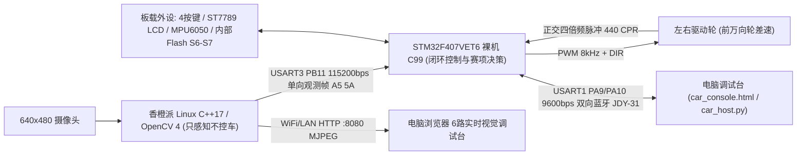
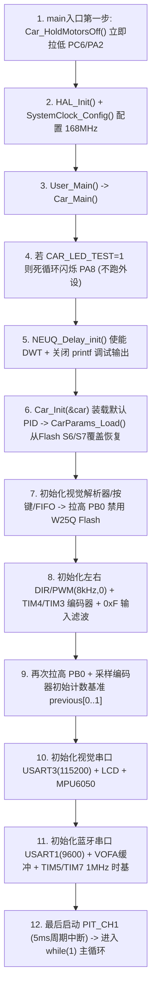
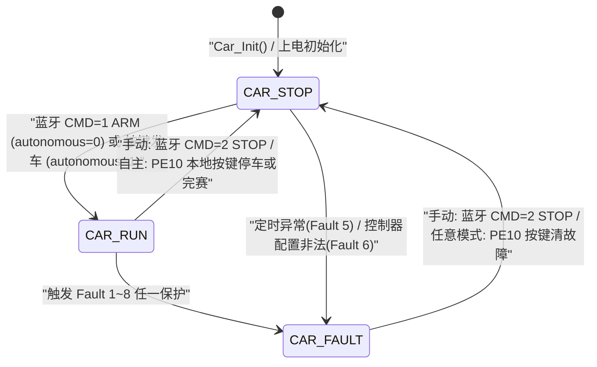
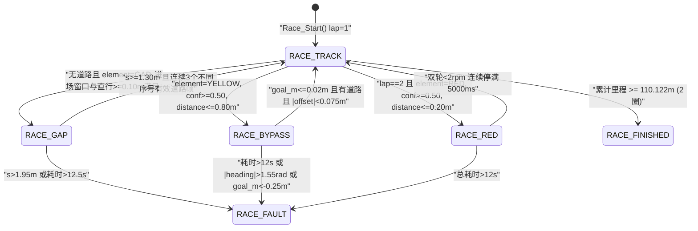
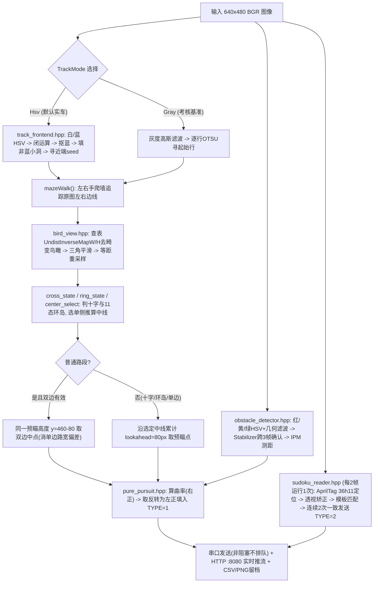
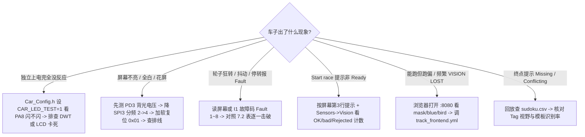

# NEUQ 智能车代码架构、使用、排障与二次开发完全手册

> [!NOTE]
> 本手册以当前工程源码为准编写，适用硬件平台为 **STM32F407VET6 双轮差速底盘 + 香橙派（Linux / OpenCV 4）+ 经典蓝牙 JDY-31 + ST7789 2.0 寸 LCD + MPU6050**。阅读本手册时，你可以把每个章节当作“作者写代码时的设计草图与操作说明书”来对照源码理解。

---

## 目录

- [第 1 章：系统全景与设计哲学](#第-1-章系统全景与设计哲学)
  - [1.1 物理系统全景架构](#11-物理系统全景架构)
  - [1.2 四大核心设计思想（为什么这样写）](#12-四大核心设计思想为什么这样写)
  - [1.3 全工程文件目录地图与阅读路线](#13-全工程文件目录地图与阅读路线)
- [第 2 章：硬件资源、引脚接线与坐标约定](#第-2-章硬件资源引脚接线与坐标约定)
  - [2.1 外设、引脚与定时器总表](#21-外设引脚与定时器总表)
  - [2.2 硬件接线红线与易踩坑点](#22-硬件接线红线与易踩坑点)
  - [2.3 物理参数基线与坐标系约定（关键符号陷阱）](#23-物理参数基线与坐标系约定关键符号陷阱)
- [第 3 章：STM32 下位机核心架构与算法精讲](#第-3-章stm32-下位机核心架构与算法精讲)
  - [3.1 上电冷启动 12 步初始化时序](#31-上电冷启动-12-步初始化时序)
  - [3.2 裸机三层并发模型与 5 ms PIT 严格节拍](#32-裸机三层并发模型与-5-ms-pit-严格节拍)
  - [3.3 测速算法与 A/B/C/D 四层抗干扰体系](#33-测速算法与-abcd-四层抗干扰体系)
  - [3.4 双模式速度规划与串级 PID 控制律](#34-双模式速度规划与串级-pid-控制律)
  - [3.5 整车状态机、控制权锁定与 8 级保护](#35-整车状态机控制权锁定与-8-级保护)
  - [3.6 自主比赛状态机、IMU 融合与数独终点收尾](#36-自主比赛状态机imu-融合与数独终点收尾)
  - [3.7 车载三级菜单、LCD 差分刷新与 PID 掉电保存](#37-车载三级菜单lcd-差分刷新与-pid-掉电保存)
- [第 4 章：香橙派视觉流水线精讲](#第-4-章香橙派视觉流水线精讲)
  - [4.1 单帧视觉处理全链路](#41-单帧视觉处理全链路)
  - [4.2 逐模块核心算法与关键阈值](#42-逐模块核心算法与关键阈值)
  - [4.3 命令行参数速查与无头浏览器看图](#43-命令行参数速查与无头浏览器看图)
- [第 5 章：双路通信协议字节级手册](#第-5-章双路通信协议字节级手册)
  - [5.1 蓝牙手动调试与 VOFA+ 遥测协议（USART1）](#51-蓝牙手动调试与-vofa-遥测协议usart1)
  - [5.2 香橙派视觉通信协议（USART3）](#52-香橙派视觉通信协议usart3)
- [第 6 章：完整使用与操作手册（SOP）](#第-6-章完整使用与操作手册sop)
  - [6.1 开发环境与编译/回归测试命令](#61-开发环境与编译回归测试命令)
  - [6.2 SOP-1：首次装车架空标定与符号核对](#62-sop-1首次装车架空标定与符号核对)
  - [6.3 SOP-2：内环速度 PID 调参、自动调参与掉电保存](#63-sop-2内环速度-pid-调参自动调参与掉电保存)
  - [6.4 SOP-3：自主比赛发车、实时监控与离线回放](#64-sop-3自主比赛发车实时监控与离线回放)
- [第 7 章：故障排查宝典](#第-7-章故障排查宝典)
  - [7.1 快速分诊决策树](#71-快速分诊决策树)
  - [7.2 故障码 Fault 0~8 速查与清除表](#72-故障码-fault-08-速查与清除表)
  - [7.3 九大实战高频问题逐项排障](#73-九大实战高频问题逐项排障)
- [第 8 章：二次开发与功能扩展实战指南](#第-8-章二次开发与功能扩展实战指南)
  - [8.1 扩展 1：增加新赛项 / 现场盲盒 / 真正终点地标](#81-扩展-1增加新赛项--现场盲盒--真正终点地标)
  - [8.2 扩展 2：新增视觉识别元素或串口观测字段](#82-扩展-2新增视觉识别元素或串口观测字段)
  - [8.3 扩展 3：启用预留的串级外环位置环](#83-扩展-3启用预留的串级外环位置环)
  - [8.4 扩展 4：接入新传感器（全六轴 IMU / 电池电压 ADC 等）](#84-扩展-4接入新传感器全六轴-imu--电池电压-adc-等)
  - [8.5 扩展 5：增加车载 LCD 菜单页或状态监控项](#85-扩展-5增加车载-lcd-菜单页或状态监控项)
  - [8.6 扩展 6：增加新的掉电保存参数](#86-扩展-6增加新的掉电保存参数)
  - [8.7 扩展 7：扩展蓝牙调试命令或修改遥测通道](#87-扩展-7扩展蓝牙调试命令或修改遥测通道)
- [第 9 章：架构红线与提交前检查清单](#第-9-章架构红线与提交前检查清单)

---

## 第 1 章：系统全景与设计哲学

### 1.1 物理系统全景架构

这套代码并不是单块单片机“一把梭”工程，而是一个**双计算节点 + 上位机调试台**构成的闭环系统：



一句话总结整套分工：**香橙派只做“眼睛”（把图像变成物理尺度下的曲率、元素、障碍距离和数独块），STM32 做“小脑+脊髓”（负责 5 ms 轮速闭环、比赛任务决策、硬件安全保护与终点解数独），电脑调试台负责“体检与标定”（手动驾驶、波形观察、FOPDT 自动调参）。**

---

### 1.2 四大核心设计思想（为什么这样写）

在动手改任何一行代码前，先理解这套源码背后坚持的 4 条原则，几乎所有看似“绕弯”的设计都能瞬间讲通：

1. **感知与执行严格解耦（视觉绝不直接发 PWM）**
   - 视觉程序哪怕崩溃、卡顿、识别错乱，也绝对不会发出“左轮转 3000 PWM”这种指令。香橙派发给 STM32 的永远只是客观观测（曲率是多少、看到什么元素、距离多少米）。
   - 真正把曲率转成左右轮速、决定何时进入断路/绕障/停 5 秒、何时降级慢走或紧急停车的，全部集中在 STM32 的 [Car_Race.c](../CODE/Car_Race.c) 和 [Car_Core.c](../CODE/Car_Core.c)。
2. **纯算法层与硬件胶水层彻底隔离（可在电脑直接单测）**
   - `CODE/` 下除了 [Car_Hardware.c](../CODE/Car_Hardware.c) 和 [Car_ParamsFlash.c](../CODE/Car_ParamsFlash.c) 外，其余 8 个核心业务模块（控制核心、PID、参考规划器、比赛状态机、数独求解、视觉协议、菜单逻辑、Flash 参数格式）**零 HAL 库依赖、零寄存器访问**。
   - 因此我们可以直接用本机 `clang`/`gcc` 把业务代码编译成电脑上的 `.exe`，在几秒钟内跑完几万步的仿真、PID 数值异常、协议错帧、断电撕裂测试（见 [Tests/](../Tests)）。
3. **裸机三层执行上下文（不用 RTOS 照样不丢帧、不堵死）**
   - **L1 串口接收中断**：只负责把收到的 1 个字节丢进环形 FIFO 队列，耗时几微秒，绝不在中断里算 CRC 或控制电机。
   - **L2 5 ms 周期控制中断（`PIT_CH1`）**：硬实时心脏。按严格次序读真实时间差 `dt_us` → 读编码器 → 处理蓝牙命令 → 扫描按键/推比赛任务 → 更新 PID 与安全保护 → 提交 PWM → 最后才解析视觉串口并推送遥测。
   - **L3 前台主循环 `while(1)`**：专门干耗时且允许分片的工作——擦写 Flash（会暂停取指）、每次最多发 4 字节蓝牙遥测、10 ms 轮询一次 MPU6050、逐行差分刷 LCD、终点后台解数独。
   - **跨层共享数据**：PIT 写、前台读时，通过极短的 `__disable_irq()` 关中断窗口复制结构体快照（例如 [Car_GetVisionObservation()](../CODE/Car_Hardware.c#L597-L610)），绝不用 `volatile` 硬扛复合结构体，也绝不在关中断状态下跑 I²C/SPI/Flash。
4. **纵深安全防御（Fail-Safe）**
   - 上电进 `main()` 的第一句（连时钟都没配之前）就先调用 [Car_HoldMotorsOff()](../CODE/Car_Hardware.c#L914-L920) 拉低两路电机使能/PWM 脚，防止复位瞬间车轮抽搐。
   - 所有电机换向强行插 1 拍 0 PWM 死区；PWM 和转速统一限幅到满量程 90%；内建 8 种硬件/通信/运动故障锁存；自主比赛期间屏蔽蓝牙指令，把物理按键 `PE10` 作为最高优先级急停键。

---

### 1.3 全工程文件目录地图与阅读路线

| 文件 / 目录 | 所属层级 | 核心职责 | 推荐阅读顺位 |
|---|---|---|---|
| [main.c](../Library/HAL_lib/Core/Src/main.c) | 启动层 | 拉低电机输出 → HAL/时钟初始化 → 调用 `User_Main()` | 1（扫一眼） |
| [NEUQ_Main.c](../User/NEUQ_Main.c) | 应用入口 | 仅调用 `Car_Main()` | 1（扫一眼） |
| [NEUQ_Interrupts.c](../User/NEUQ_Interrupts.c) | 中断分发 | 把 `PIT_CH1` 和 `UART_0`/`UART_2` 回调转给 `Car_Hardware.c` | 2 |
| [Car_Config.h](../CODE/Car_Config.h) | 全局配置 | 全部引脚、周期、CPR、方向/编码器极性、PID 默认值、保护阈值 | **必读 1** |
| [Car_Core.h](../CODE/Car_Core.h) / [Car_Core.c](../CODE/Car_Core.c) | **纯算法核心** | 状态机、蓝牙协议解析、8 拍滑动测速、野值守卫、PID 调度、8 种故障保护 | **必读 2** |
| [Car_Hardware.h](../CODE/Car_Hardware.h) / [Car_Hardware.c](../CODE/Car_Hardware.c) | **硬件适配层** | 外设初始化、5 ms 控制节拍、PWM 换向死区、前台轮询、临界区快照 | **必读 3** |
| [Car_PID.h](../CODE/Car_PID.h) / [Car_PID.c](../CODE/Car_PID.c) | 纯算法 | 位置式 PID（预留外环）+ 增量式 PID（内环速度环，带重锚与抗饱和） | 4 |
| [Car_Reference.h](../CODE/Car_Reference.h) / [Car_Reference.c](../CODE/Car_Reference.c) | 纯算法 | 手动模式双轮共享进度的五次多项式 S 曲线规划器 | 5 |
| [Car_Race.h](../CODE/Car_Race.h) / [Car_Race.c](../CODE/Car_Race.c) | 纯算法 | 自主比赛状态机（巡线、断路、绕黄障、红障停 5 s、差速运动学） | **必读 4** |
| [Car_Vision.h](../CODE/Car_Vision.h) / [Car_Vision.c](../CODE/Car_Vision.c) | 纯算法 | 香橙派 `A5 5A` 协议解析、CRC16、会话/序号/200 ms 时效校验 | 6 |
| [Car_Sudoku.c](../CODE/Car_Sudoku.c) | 纯算法 | 4 块 3×3 拼 6×6 数独（2×3 宫）、MRV 唯一解搜索（限 20000 节点） | 7 |
| [Car_Menu.h](../CODE/Car_Menu.h) / [Car_Menu.c](../CODE/Car_Menu.c) | 纯算法 | 车载 3 级菜单导航、发车门控、PID 编辑逻辑、10×32 行渲染 | 8 |
| [Car_Params.h](../CODE/Car_Params.h) / [Car_Params.c](../CODE/Car_Params.c) | 纯算法 | 64 字节 PID 持久化记录格式、CRC32、双区滚动查找/提交 | 9 |
| [Car_ParamsFlash.h](../CODE/Car_ParamsFlash.h) / [Car_ParamsFlash.c](../CODE/Car_ParamsFlash.c) | 硬件适配 | STM32 内部 Flash S6/S7 扇区擦写与数据缓存管理 | 9 |
| [My_Key.c](../CODE/My_Key.c) / [My_Lcd.c](../CODE/My_Lcd.c) / [My_Vofa.c](../CODE/My_Vofa.c) | 交互/遥测驱动 | 按键 30 ms 消抖与长按连发、LCD 逐字符差分刷屏、JustFloat 遥测缓冲 | 10 |
| [NEUQ_lib_include.h](../Library/NEUQ_lib/NEUQ_lib_include.h) | 底层库 | NEUQ 开源 HAL 封装库（PWM、Encoder、UART、FIFO、LCD200、MPU6050 等） | 按需查阅 |
| [vision_inspection/vision/](../vision_inspection/vision/README.md) | 香橙派视觉 | C++17 + OpenCV 4 巡线、逆透视鸟瞰、路障识别、AprilTag 数独、HTTP 看图 | **视觉必读** |
| [Tools/](../Tools/car_console_README.md) | 调试与脚本 | `car_console.html` 网页台、`car_host.py`、`vision_link.py`、`check_*` 脚本 | 使用必看 |
| [Tests/](../Tests) | 自动化回归 | 覆盖控制、PID、视觉协议、比赛、数独、菜单、Flash、前端、网页台的测试 | 改码必跑 |

---

## 第 2 章：硬件资源、引脚接线与坐标约定

### 2.1 外设、引脚与定时器总表

主控 **STM32F407VET6**，主频 **168 MHz**（HSI 经 PLL 倍频，见 [main.c](../Library/HAL_lib/Core/Src/main.c#L120-L146)），APB1 = 42 MHz（定时器倍频为 84 MHz），APB2 = 84 MHz（定时器倍频为 168 MHz）。

| 功能子系统 | MCU 引脚 | 片上外设 / 驱动参数 | 代码宏 / 关键配置 |
|---|---|---|---|
| **左轮驱动（通道 1）** | PWM `PC6`，DIR `PC7` | `TIM8_CH1`，8 kHz PWM，满量程 10000 | `CAR_LEFT_PWM`、`CAR_LEFT_DIR`、`CAR_LEFT_FORWARD_HIGH = 1` |
| **右轮驱动（通道 2）** | PWM `PA2`，DIR `PA5` | `TIM2_CH3`，8 kHz PWM，满量程 10000 | `CAR_RIGHT_PWM`、`CAR_RIGHT_DIR`、`CAR_RIGHT_FORWARD_HIGH = 0` |
| **左轮编码器** | A 相 `PB6`，B 相 `PB7` | `TIM4` 正交四倍频，440 CPR，滤波 `0xF` (~3 µs) | `Encoder_TIM4`、`CAR_LEFT_ENCODER_INVERT = 1` |
| **右轮编码器（默认）** | A 相 `PA6`，B 相 `PA7` | `TIM3` 正交四倍频，440 CPR，滤波 `0xF` (~3 µs) | `Encoder_TIM3`、`CAR_RIGHT_ENCODER_INVERT = 0` |
| **右轮编码器（C 方案备选）** | A 相 `PA0`，B 相 `PA1` | `TIM5` 正交四倍频（摆脱与 W25Q 的引脚复用） | 设 `CAR_RIGHT_ENCODER_ON_TIM5 = 1` 后启用 |
| **板载 W25Q Flash** | `PB0` (CS)，共用 `PA5/6/7` | **本项目禁止使用该芯片**，开机拉高 `PB0` 使其处于高阻态 | `CAR_FLASH_CS = PB0` |
| **蓝牙模块 JDY-31** | `PA9` (TX)，`PA10` (RX) | `USART1`（NEUQ 库索引 `UART_0`），`9600 8N1` | `CAR_UART_INDEX = 0`，中断优先级 `3` |
| **香橙派视觉串口** | `PB10` (TX)，`PB11` (RX) | `USART3`（NEUQ 库索引 `UART_2`），`115200 8N1` | `CAR_VISION_UART_INDEX = 2`，中断优先级 `4` |
| **陀螺仪 MPU6050** | `PA8` (SCL)，`PC9` (SDA) | `I2C3` 硬件 I²C，400 kHz，7 位地址 `0x68` | `Hard_IIC_3`，库宏 `MPU6050_ADDR = (0x68 << 1)` |
| **2.0 寸 LCD 屏** | `PB3`(SCK) `PB5`(MOSI) `PB4`(CS) | `SPI3`（~21 MHz，模式 0）+ `DC=PD5, BL=PD3, RST=PE2` | [NEUQ_LCD200.h](../Library/NEUQ_lib/NEUQ_lib_Device/NEUQ_LCD200.h#L40-L46) |
| **车载四向按键** | `PE10`(上) `PE8`(下) `PE7`(OK) `PE9`(返回) | 内部上拉输入，低电平有效 | **运行/故障时 `PE10` 同时充当最高优先级急停键** |
| **控制节拍定时器** | 无外部引脚 | `TIM6` (`PIT_CH1`)，周期 5 ms，最高优先级 `0` | `CAR_PERIOD_MS = 5U` |
| **微秒测量时基** | 无外部引脚 | 默认 `TIM5` (32 位 1 MHz)；C 方案自动切换为 `TIM7` (16 位 1 MHz) | `init_control_clock()` |
| **参数存储内部 Flash** | 片上存储 | 扇区 S6/S7：`0x08040000 ~ 0x0807FFFF` (2 × 128 KiB) | Keil 代码区必须限定在前 256 KiB (`0x08000000~0x0803FFFF`) |

---

### 2.2 硬件接线红线与易踩坑点

> [!CAUTION]
> 接线与改引脚时若触犯以下任何一条硬约束，轻则无反应/乱码，重则烧管或飞车：
> 1. **左轮动力与反馈同通道、右轮同理**：从车后向前看，左轮电机接驱动板通道 1（U9），左编码器接 `TIM4`；右轮电机接通道 2（U8），右编码器接 `TIM3`。绝不可出现“左轮电机接右轮编码器”的交叉混接。
> 2. **驱动板使能开关**：检查驱动板 `SW1` 必须拨到使能 `nSLEEP`，否则 PWM 再大电机也不会转。
> 3. **PC6 不可用 TIM3 输出 PWM**：因为 `TIM3` 已被右编码器占用。
> 4. **PA5/PA6/PA7 与板载 W25Q 冲突**：这三根线既接了右轮 DIR/编码器，又连着核心板上的 W25Q Flash。软件开机把片选 `PB0` 拉高来隔离它，但**绝不允许**再初始化 SPI1 或 W25Q，否则车轮必抽搐。
> 5. **串口电平与交叉接法**：香橙派 3.3 V TTL `TX` 接 STM32 `PB11`（`RX`），必须共地；JDY-31 带底板版本建议 VCC 接 3.6~6 V（5 V），裸模块仅 1.8~3.6 V。

---

### 2.3 物理参数基线与坐标系约定（关键符号陷阱）

- **轮胎半径**：`RACE_RADIUS_M = 0.0325f`（65 mm 外径几何初值）。
- **有效轮距**：`RACE_TRACK_M = 0.173f`（轮胎外缘总宽 200 mm、内缘净距 146 mm 的平均值，需原地旋转实测回填）。
- **编码器分辨率**：电机轴 11 PPR × 定时器正交 4 倍频 × 减速比 10:1 = **440 counts/rev**（[Car_Config.h](../CODE/Car_Config.h#L61)）。
- **电机满量程与 90% 安全上限**：空载输出轴 `1000 rpm`、PWM 满量程 `10000`；指令限速与超速阈值统一为满量程的 90%（**`±900 rpm`** / **`±9000 PWM`**）。

> [!IMPORTANT]
> **必须牢记的左右正负号约定（跨端唯一符号边界）**：
> - **STM32 下位机 & 蓝牙/视觉线协议**：轮 0 = 左轮，轮 1 = 右轮；前进为正；车体**向左偏 / 逆时针转（CCW）为正**（`lateral_m > 0`、`heading_rad > 0`、`curvature_inv_m > 0`、`gyro_rate > 0`）。
> - **香橙派视觉算法内部（鸟瞰图/Pure Pursuit）**：图像坐标 `x` 向右增加，所以算法内部算出的 `lateralError` 和 `curvature` 是**向右为正**。
> - **转换点**：在 [img_handle.hpp](../vision_inspection/vision/img_handle.hpp#L478-L479) 打包进 `wireObservation` 的那一刻，代码主动乘了 `-1000.f` 取反，才送到串口！自己写新视觉字段时千万别弄反了符号。

---

## 第 3 章：STM32 下位机核心架构与算法精讲

### 3.1 上电冷启动 12 步初始化时序

如果你想知道芯片从通电第 1 纳秒到进入控制循环到底干了什么，顺着这条链看 [main.c](../Library/HAL_lib/Core/Src/main.c#L64-L90) → [NEUQ_Main.c](../User/NEUQ_Main.c#L77-L85) → [Car_Hardware.c](../CODE/Car_Hardware.c#L922-L1045) 即可：



**为什么顺序不能乱？**
- **为什么第 5 步要单独调 `NEUQ_Delay_init()`？** 连着 ST-Link 调试时，调试器会帮你把内核 DWT 计数器打开；但拔掉调试器独立电池供电时 DWT 默认是关的！如果不显式初始化，后面依赖微秒延时的外设（比如 I²C/LCD）会直接卡死。
- **为什么第 5 步要关 `printf` (`NEUQ_Debug_set_output_enabled(0)`)？** NEUQ 库的 `NEUQ_LCD200_init()` 里面居然会调 `printf`！而本板把 USART1 让给了蓝牙且此时蓝牙还没初始化，不关掉 `printf` 就会死等串口发送标志把整个板子卡死。
- **为什么第 12 步才开 `PIT_CH1`？** 保证编码器基准 `previous[]`、控制时基 `last_control_us`、各队列全部建好后再开定时器，绝不让中断访问半成品对象。

---

### 3.2 裸机三层并发模型与 5 ms PIT 严格节拍

整个系统没有用 FreeRTOS，而是靠下面这个精确的三层分工做到零死锁、低延迟：

```mermaid
sequenceDiagram
    participant UART_ISR as "串口 RX 中断 (最高抢占)"
    participant PIT as "PIT_CH1 5ms 控制中断 (TIM6)"
    participant MAIN as "主循环 while(1) 前台任务"

    UART_ISR->>PIT: "仅将单字节写入 rx_fifo / vision_fifo"
    Note over PIT: "1. 读 TIM5/TIM7 得真实 dt_us, 读 TIM4/TIM3 算增量 l/r"
    Note over PIT: "2. 若正在写 Flash (params_pending), 零输出并跳过本拍"
    Note over PIT: "3. 从 rx_fifo 消费最多 32B -> Car_FeedByte()"
    Note over PIT: "4. race_tick(): 按键消抖(PE10急停优先) + 菜单 + Race_Step()"
    Note over PIT: "5. Car_TickDt(): 测速/参考/PID/保护 -> output() 写电机PWM"
    Note over PIT: "6. 从 vision_fifo 消费最多 64B -> CarVision_Feed()"
    Note over PIT: "7. finish_tick() 终点收尾; 每20拍推1帧VOFA到发送FIFO"
    MAIN->>MAIN: "1. poll_params(): 若需保存则在主循环擦写内部Flash"
    MAIN->>MAIN: "2. My_Vofa_poll(): 每次最多发4字节(防堵死后续外设)"
    MAIN->>MAIN: "3. poll_gyro(): >=10ms 读取MPU6050 Z轴并写带时间戳快照"
    MAIN->>MAIN: "4. poll_menu(): >=120ms 取临界区快照 -> 逐行刷新LCD / 终点解数独"
```

**这里有两个极其细腻的工程考量：**
1. **为什么把 `CarVision_Feed()` 放在 `output()` 写完电机 PWM 之后？**
   视觉协议一帧最长 48 字节还要算 CRC16。把它放在电机控制之后执行，就算某一拍视觉串口一口气涌来 64 字节，也绝不会增加编码器采样到 PWM 输出之间的延迟抖动！代价只是本拍控制用到的是上一拍刚解析好的视觉帧（最多差 5 ms）。
2. **为什么 `My_Vofa_poll()` 每次最多只发 4 个字节？**
   蓝牙默认 9600 波特率，发 1 个字节要 ~1.04 ms，一帧 68 字节如果一次性在主循环里发完要独占 CPU 70 ms！拆成每次发 4 字节（~4 ms），中间穿插服务 `poll_gyro()` 和 `poll_menu()`，陀螺仪 10 ms 采样周期才能稳住。

---

### 3.3 测速算法与 A/B/C/D 四层抗干扰体系

#### 1. 为什么非要用“8 拍滑动窗口”测速？
本车输出轴一圈只有 440 个脉冲。如果按传统写法用单拍 5 ms 脉冲数算转速：
$$\Delta \text{rpm}_{\text{1 tick}} = \frac{1 \times 60}{440 \times 0.005} \approx 27.27\text{ rpm}$$
也就是说，每 5 ms 编码器多跳 1 个脉冲，实测速度就会**瞬间跳变 27.3 rpm**！如果此时 `Kp = 8.0`，PWM 输出直接抽风跳动 218（占空比 2.2%）；在低速 30 rpm 时更是只有 1 个脉冲和 2 个脉冲之间 90% 的剧烈台阶震荡。

因此 [Car_Core.c](../CODE/Car_Core.c#L184-L237) 引入了 `CAR_SPEED_WINDOW_TICKS = 8`（标称 40 ms）环形滑动窗口：
$$\text{rpm}_{\text{raw}} = \frac{\sum_{k=0}^{N-1} \text{counts}[k] \times 60 \times 10^6}{\text{CPR} \times \sum_{k=0}^{N-1} \text{dt\_us}[k]}$$
1 个脉冲的量化台阶瞬间压低 **8 倍** 到 **3.41 rpm**，之后再过一道时间常数 $\tau = 0.015\text{ s}$ 的一阶低通滤波器：
$$\text{speed} \leftarrow \text{speed} + \frac{dt}{\tau + dt} (\text{rpm}_{\text{raw}} - \text{speed})$$
- **代价也要心里有数**：40 ms 窗口的一半（20 ms）+ 15 ms 低通 ≈ **35 ms 测速滞后**。在 200 rpm/s 斜坡加速时，会有约 7 rpm 的预期跟随滞后，属于正常物理现象，不要误以为 PID 调不动。

#### 2. A / B / C / D 四层编码器抗干扰方案（都在 [Car_Config.h](../CODE/Car_Config.h#L62-L94)）

| 层级 | 实现位置 | 原理与效果 | 状态 |
|---|---|---|---|
| **A 方案（片选隔离）** | `Car_Main()` 拉高 `PB0` | 防止共脚的板载 W25Q 向 PA6(MISO) 输出杂波干扰右编码器 | 默认开启 |
| **B 方案（硬件滤波）** | `encoder_input_filter(..., 0xF)` | TIM3/TIM4/TIM5 输入捕获设 `IC1F=IC2F=0xF`（~3 µs 滤毛刺；1000 rpm 时正常边沿间隔 136 µs，绝不丢脉冲） | 默认开启 |
| **C 方案（彻底换脚）** | `CAR_RIGHT_ENCODER_ON_TIM5 = 1` | 若怀疑 PA5/6/7 硬件冲突太重，把右编码器改焊到 **`PA0/PA1` (TIM5)**，控制时基自动退给 16 位 **TIM7** | 可选开关（默认 0） |
| **D 方案（软件守卫）** | `CAR_SPEED_GUARD_ENABLE = 1` | 双重拦截野值，判为野值时本拍保持 `output_last` 防 PWM 掉零抽搐；**开环调参时自动旁路** | 默认开启 |

D 方案的两个拦截门（[Car_Core.c](../CODE/Car_Core.c#L862-L927)）：
1. **单拍脉冲物理上限守卫**：单拍计数绝对值超过 `1.5 × (440 × 1000 / 60 × dt_s)`，用上一拍速度推算的计数替换；但连续超限达到 `CAR_SPEED_GUARD_HOLD_TICKS`（3 拍）则放行交给超速保护，避免挡住真实飞车。
2. **窗口转速跳变守卫**：正常参考加速度 200 rpm/s 时 5 ms 只变 1 rpm；若单拍窗口转速突变超过 `150 rpm` 且持续不足 3 拍，保持上一次有效值并使 `guarded = 1`；若持续超过 3 拍则放行认为是真实急变速。事件累计在 `car.count_reject[]` 和 `car.speed_reject[]` 供调试器观察。

---

### 3.4 双模式速度规划与串级 PID 控制律

#### 1. 参考转速如何生成？（为什么手动和自主不一样？）
- **手动蓝牙模式（[Car_Reference.c](../CODE/Car_Reference.c#L221-L358)）**：人手按键给的是阶跃目标（0 → 100 rpm）。为了不起步抬头打滑，代码生成双轮共享进度的**五次多项式 S 曲线** $s(\tau) = 10\tau^3 - 15\tau^4 + 6\tau^5$，同时保证加速度 $\le 200\text{ rpm/s}$、加加速度（Jerk）$\le 800\text{ rpm/s}^2$，并且**速度变化大的那个轮子决定总时间 $T$**，两轮同起点同终点按比例起步，走直线绝不画龙！如果中途改目标时还有加速度，会先走 `Phase 2` 把当前加速度线性降到 0 再重规划。
- **自主比赛模式（[Car_Core.c](../CODE/Car_Core.c#L825-L838)）**：视觉每帧（~30 ms）都在给新曲率和新轮速，如果用五次曲线每帧重启就永远走不动。因此自主模式下改用**双轮同比加速度斜率限幅器（Slew Limiter）**：限制每拍最大变化量不超过 `CAR_ACCEL_LIMIT_RPM_S * dt`，且两轮按相同比例缩放步长。

#### 2. 串级双环 PID 算法细节（[Car_PID.c](../CODE/Car_PID.c)）

系统设计了**外环位置式位置环 → 内环增量式速度环**两级结构（当前默认 `CAR_CASCADE_OUTER_ENABLE = 0` 旁路外环，规划器参考直通内环）。

内环速度环 [`Car_PidInc_update_dt()`](../CODE/Car_PID.c#L559-L712) 是整台车最硬核的控制器之一，核心公式如下：

$$P_k = K_p \cdot (\beta \cdot r_k - y_k), \quad D_k = -K_d \cdot 0.005 \cdot \dot{y}_{f,k}, \quad FF_k = K_v \cdot r_k + K_a \cdot a_k + \text{sgn}(r_k) K_s$$

$$\Delta I_k = \text{clip}\!\left(I_{k-1} + K_i \cdot (r_k - y_k) \cdot \frac{dt}{0.005},\; I_{\max}\right) - I_{k-1}$$

$$\Delta u_k = (P_k - P_{k-1}) + \Delta I_k + (D_k - D_{k-1}) + (FF_k - FF_{k-1}), \quad u_k = u_{k-1} + \Delta u_k$$

为什么写得这么讲究？逐条拆给你看：
- **为什么 `Ki`、`Kd` 要乘除 `0.005`？** 实验室老工具和上位机都是按 5 ms 标定的参数，保留这个历史约定后，即便某拍实际 `dt` 抖动到了 4.8 ms 或 5.3 ms，积分和微分物理作用量依然严格一致，不会因为采样抖动产生飘移！
- **为什么用未限幅值 `unclamped_output` 做递推，还要每 8 拍重锚？** 如果拿限幅后的 `last_output` 递推，P 项顶到 9000 上限后再往回降，输出会被“拽”住失去历史；保留未限幅基准就不会产生退饱和反向冲击。但单精度 float 反复做差再累加会有微小舍入误差，所以每 8 拍用数学等价的绝对式 `base + integral` 对齐一次（不改变饱和逻辑）。
- **只对测量值求微分 + 20 ms 一阶低通**：目标值阶跃时 `target` 突变，因为 `D` 项只算 `-Kd * 0.005 * d(measure)/dt`，彻底消除微分冲击（Derivative Kick）。
- **条件积分抗饱和**：当未限幅输出已经超出 `±9000` 且误差仍往同一饱和方向推时，本拍只撤掉 $\Delta I_k$，保留 $\Delta P, \Delta D, \Delta FF$ 照常工作。
- **非对称静摩擦前馈 $K_s$**：根据 2026-11-18 实车开环阶跃标定，左轮 5% 能稳起步、右轮 8% 才不卡住，所以 [Car_Config.h](../CODE/Car_Config.h#L152-L153) 分别设了 `CAR_FF_KS_LEFT = 500.0f` 和 `CAR_FF_KS_RIGHT = 800.0f`（仅当 $|r_k| > 1.0\text{ rpm}$ 时按符号叠加）。
- **换向 1 拍死区（[output()](../CODE/Car_Hardware.c#L461-L505)）**：如果正 PWM 突然变负 PWM，第 1 拍先把 PWM 降到 `0` 并置 `waiting[i] = 1`，**下一拍（5 ms 后）再翻转 `DIR` 引脚并输出新 PWM**，彻底保护驱动芯片 H 桥不炸管。

---

### 3.5 整车状态机、控制权锁定与 8 级保护



> [!WARNING]
> **必须注意控制权规则**：一旦通过车载按键进入自主比赛（`autonomous = 1`），`Car_Core.c` 的 [`execute()`](../CODE/Car_Core.c#L564-L566) 第一行就会拦截**全部蓝牙命令（包括蓝牙 STOP！）**。这么写是为了防止比赛场旁有人蓝牙误连误触把车停掉。因此**自主跑车时只能用板载 `PE10` 急停**！

**8 级安全保护逻辑**（[Car_Core.h](../CODE/Car_Core.h#L38-L49)）：
- 锁存原则：**只记录第一次出事的 `fault` 码**（防止后续保护把真凶覆盖掉），立刻把目标/输出归零。
- 堵转保护（Fault 2）：参考 $\ge 40\text{ rpm}$（或开环测试中）且 PWM 输出 $\ge 1500$（15%），但实测绝对速度 $< 10\text{ rpm}$ 持续 `1500 ms`。
- 方向异常保护（Fault 3）：参考/输出方向与实测方向相反、实测 $> 100\text{ rpm}$ 且不是正在明显减速（`abs_speed >= slow_speed - 5`），持续 `1000 ms`。
- 超速保护（Fault 8）：实测转速持续超过 `900 rpm`（满量程 90%）达 `100 ms`。
- 时序保护（Fault 5）：`dt_us` 超出 `[1000, 15000]` µs 区间，立即停车。

---

### 3.6 自主比赛状态机、IMU 融合与数独终点收尾

自主比赛的逻辑全部封装在 [Car_Race.c](../CODE/Car_Race.c) 中：



#### 1. 里程计与 MPU6050 互补融合
- 每拍从编码器换算左右轮位移 `dl`, `dr`（米）：
  $$ds = \frac{dl + dr}{2}, \quad d\psi_{\text{odo}} = \frac{dr - dl}{\text{RACE\_TRACK\_M}}$$
- 上电后前台 `poll_gyro()` 在车静止且 `|rate| <= 0.12 rad/s` 时连续采 100 个 Z 轴样本求均值零偏；校准完后发布带时间戳 `gyro_stamp` 的 `gyro_rate`。
- 若 MPU6050 在线且数据新鲜度 $\le 40\text{ ms}$，则航向增量做互补融合：
  $$d\psi = 0.85 \cdot \omega_z \cdot dt + 0.15 \cdot d\psi_{\text{odo}}$$
  一旦 I²C 掉线或超时，自动无缝退化为纯编码器差分航向，不会影响比赛继续跑。

#### 2. 巡线速度规划与防内轮倒转
- **横向加速度限速**：$v_{\text{curve}} = \sqrt{\frac{0.55}{|\kappa| + 0.01}}$，第一圈最高 `0.55 m/s`，第二圈最高 `0.32 m/s`；遇环岛/十字或置信度 $< 0.65$ 降为 `0.24 m/s`；二圈见红障降为 `0.20 m/s`；距终点减速至停。
- **视觉丢线降级**：当前版本不再一丢曲率就急停，而是维持 `last_curve` 并降速到 `RACE_VISION_HOLD_SPEED_MPS`（`0.18 m/s`），在 LCD 状态栏提示 `VISION LOST`（若想改回超时硬停，设置 [Car_Race.h](../CODE/Car_Race.h#L25) 的 `RACE_VISION_LOST_STOP_MS` 为非零毫秒数）。
- **防内轮倒转钳位**：在 `drive(v, omega)` 里强制把半差速限制在 $|\text{half}| \le |v|$，保证弯道极急时内侧轮最多减到 0 rpm，绝不被地面强行往前拖着做反转指令而触发堵转/方向故障。

#### 3. 终点收尾与 6×6 数独求解
1. 当 `distance >= 110.122 m`（2 圈练习终点），`race_tick()` 置 `finish_pending = 1` 并停下小车，锁死禁止新发车和新 HELLO。
2. `finish_tick()` 确认双轮 $< 2\text{ rpm}$ 停稳 100 ms 后检查 4 块数独是否收齐；若缺块，最多再等 **1000 ms** 给正在路上的最后一帧数独数据到达。
3. 冻结 4 块 3×3 快照（按 `0=TL, 1=TR, 2=BL, 3=BR` 拼成 6×6 棋盘），在前台 `poll_menu()` 里调用 [Race_SolveDetailed()](../CODE/Car_Sudoku.c#L42-L64)：按 **2×3 宫（不是 3×2！）** + 行 + 列做位掩码 MRV（最少候选格优先）回溯，检查是否**有且仅有唯一解**（节点预算 20000 防卡死界面），最终把 6×6 答案或具体失败原因显示在 LCD 上。

---

### 3.7 车载三级菜单、LCD 差分刷新与 PID 掉电保存

#### 1. 菜单结构与操作键位
按键：`PE10` 上（运行/故障中优先急停）、`PE8` 下、`PE7` 确认 (OK)、`PE9` 返回 (BACK)。按住上下键 500 ms 后每 100 ms 连发。

| 一级分类 | 二级菜单项 | 第三级页面内容 / 操作 |
|---|---|---|
| **Race** | `Start race` | 展示 5 道发车门控检查结果；显示 `Ready` 后按 `OK` 立即发车 |
| **Race** | `Race status` | 当前圈数 `Lap`、赛段 `Phase`、累计里程、融合航向角、已收子块数 `Tiles X/4` |
| **Race** | `Sudoku result` | 途中显示 `TL/TR/BL/BR` 接收状态；完赛显示 6×6 答案或报错原因 |
| **Sensors** | `Wheel speeds` | 左右轮参考 `Ref`、实测 `RPM`、占空比 `PWM%` |
| **Sensors** | `IMU / MPU6050` | 传感器状态、零偏校零 `0~100` 进度、Z 轴零偏与实时角速度 (°/s) |
| **Sensors** | `Vision` | 当前 `Session`、帧号、置信度、曲率、元素，以及 `OK / bad / Rejected` 累计统计 |
| **Left wheel inner PID** | `Kp / Ki / Kd` | 单击 ±0.01、连发 ±0.10（0~655.35）；`OK` 应用到 RAM，`BACK` 放弃 |
| **Right wheel inner PID** | `Kp / Ki / Kd` | 同上（针对右轮） |
| **左/右 PID 子菜单第 4 项** | `Save parameters` | 停稳后按 `OK` 一次性将**左右两轮共 6 个已生效参数**写入内部 Flash |

#### 2. LCD 为什么刷新快还不闪？
SPI3 屏全屏清屏要传 76800 像素（几十毫秒）。[My_Lcd.c](../CODE/My_Lcd.c#L52-L94) 在内存里缓存了 10 行 × 32 列的字符和颜色样式：
- 样式没变时逐字符对比，**只把发生变化的那几个 ASCII 字符通过 `NEUQ_LCD200_DisplayChar` 发给屏幕**，刷新一个浮点数往往只重画两三个字符。

#### 3. 双扇区追加型 Flash 掉电保存（[Car_Params.c](../CODE/Car_Params.c) & [Car_ParamsFlash.c](../CODE/Car_ParamsFlash.c)）
因为外部 W25Q 引脚冲突不能用，参数保存在 STM32 内部 Flash 末尾两个 128 KiB 扇区 **S6 (`0x08040000`)** 和 **S7 (`0x08060000`)**：
- **64 字节记录结构（16 个 `uint32_t`）**：

| 字偏移 | 字段 | 值 / 含义 |
|---|---|---|
| Word 0 | `MAGIC` | `0x50494431` (`"PID1"`) |
| Word 1 | `VERSION` | `1` |
| Word 2 | `SEQUENCE` | 递增记录序号（上电扫描取最高有效序号） |
| Word 3 | `COUNT` | `6`（参数个数） |
| Word 4~9 | `GAIN[2][3]` | `left(Kp, Ki, Kd)`、`right(Kp, Ki, Kd)` 共 6 个 `float` |
| Word 10~13 | `RESERVED` | 保持全 `0xFFFFFFFF`（预留 4 个字扩展空间！） |
| Word 14 | `CRC32` | 对前 14 个字算小端 IEEE CRC32 |
| Word 15 | `COMMIT` | `0x434F4D54` (`"COMT"`)，**必须最后一个写入**，保证断电半写可识别 |

- **写穿与防掉电丢失设计**：每区可追加写 2048 条，写满才切到另一区擦除；擦目标区时**绝对不擦旧记录所在区**，写完读回全字节校验无误才算成功。
- **F407 单 Bank Flash 取指暂停握手**：写 Flash 时 CPU 会卡住无法取指令。因此 `CarMenu_Key` 只置 `params_pending = 1` 并在主循环 `poll_params()` 写 Flash；期间 PIT 中断保持零输出跳过控制，写完后清空硬件 UART `ORE` 溢出标志、清 FIFO 与旧快照，并置 `params_rebase = 1` 丢弃第 1 拍失真 `dt` 后恢复运行。

---

## 第 4 章：香橙派视觉流水线精讲

视觉工程位于 [vision_inspection/vision/](../vision_inspection/vision/README.md)，全 C++17 Header-only 架构，主入口是 [main.cpp](../vision_inspection/vision/main.cpp)，核心单帧函数是 [img_handle.hpp](../vision_inspection/vision/img_handle.hpp#L219-L506)。

### 4.1 单帧视觉处理全链路



---

### 4.2 逐模块核心算法与关键阈值

1. **赛道前端分割（[track_frontend.hpp](../vision_inspection/vision/track_frontend.hpp) & [track_frontend.yml](../vision_inspection/vision/track_frontend.yml)）**
   - 提取白色赛道（低饱和 `white_max_s=85`、高亮度 `white_min_v=110`）和蓝色背景（`H: 90~135, S>=70, V>=30`）。
   - 做小闭运算补细缝后**强行扣除所有蓝色像素**，再填平内部非蓝色小孔洞（面积 `<=1500` 且不碰蓝边，防止把断路蓝底补成白路）。
   - `findSeed()` 从底向上找同时满足“宽度 `>=12%` 画面宽、不贴边、左右外侧 `blue_probe=12` 像素内至少 `50%` 是蓝色”的白色亮条作为巡线种子；如果近端全被蓝底占满（`>85%`），则在 `img_handle.hpp` 发出 `Element::Gap` 候选。
2. **鸟瞰变换与 Pure Pursuit（[bird_view.hpp](../vision_inspection/vision/bird_view.hpp) & [pure_pursuit.hpp](../vision_inspection/vision/pure_pursuit.hpp)）**
   - 直接查预标定表 `calibration/UndistInverseMapW.txt` 和 `UndistInverseMapH.txt` 把原图像素一步映射到 640×480 鸟瞰平面（车体原点在 `(300, 460)`，比例尺 `kMetersPerPixel = 0.45 / 192`，预瞄 `80` 像素，半路宽 `96` 像素）。
   - 曲率计算公式：
     $$\kappa = \frac{2 \cdot \Delta x_{\text{lateral}}}{\Delta x_{\text{lateral}}^2 + \Delta y_{\text{forward}}^2}$$
   - **重要**：普通弯道优先在预瞄高度 `y = vehiclePoint.y - lookahead` 处直接求左右边界交点中点（只要两边界间距在 `0.22 m ~ 0.72 m` 之间），可消除单边线偏半路宽推算的误差！
3. **十字与 11 态环岛状态机（[cross_state.hpp](../vision_inspection/vision/cross_state.hpp)、[ring_state.hpp](../vision_inspection/vision/ring_state.hpp)、[center_select.hpp](../vision_inspection/vision/center_select.hpp)）**
   - **十字状态机**：`None` →（双边角点连续 2 帧）`Begin` →（角点近或双边变短）`In` →（双边先暂失后恢复 3 帧）`None`。
   - **环岛状态机**：一侧有角点且对侧为长直线（`isLongStraight`）持续 4 帧进入 `LeftBegin`/`RightBegin`，依次走完 `Begin → In → Running → Out → End → None` 共 11 个状态，靠 `selectRingCenter()` 切换贴左中线或贴右中线。
4. **路障检测与稳定器（[obstacle_detector.hpp](../vision_inspection/vision/obstacle_detector.hpp)）**
   - 独立跑红（双段 H: `0~10` 和 `170~179`）、黄（`15~37`）、绿（`38~90`）分割，按面积 `25~20000`、圆形度 `>=0.30`、饱满度 `>=0.25`、长宽比 `<=2.8` 及视野边缘保护筛选。
   - `Stabilizer` 跨帧关联（半径 `45 px`），连续命中 `3` 帧置 `stable=true`，允许短暂漏检 `5` 帧不掉轨；主目标通过鸟瞰查表换算出前方距离 `forwardM` 写入协议。
5. **数独识别与防误传机制（[sudoku.hpp](../vision_inspection/vision/sudoku.hpp) & [sudoku_reader.hpp](../vision_inspection/vision/sudoku_reader.hpp)）**
   - 每隔一帧（`frames % 2 == 0`）运行 `tileReader.readAll(current)`，同时可识别画面中的多个子块：

| 子块编号 | 棋盘位置 | AprilTag 36h11 对角 ID | 映射到 6×6 棋盘位置 |
|---|---|---|---|
| `0` | 左上 (TL) | `0` (左上) / `1` (右下) | 第 1~3 行，第 1~3 列 |
| `1` | 右上 (TR) | `2` (左上) / `3` (右下) | 第 1~3 行，第 4~6 列 |
| `2` | 左下 (BL) | `4` (左上) / `5` (右下) | 第 4~6 行，第 1~3 列 |
| `3` | 右下 (BR) | `6` (左上) / `7` (右下) | 第 4~6 行，第 4~6 列 |

   - 通过 Tag 中心定位并寻找网格外框四边形做 300×300 透视矫正（**只取网格内部，裁掉外面 Tag**），用缩放归一化后的多尺度/多线宽字体模板匹配 `1~6`，墨水比 `< 0.018` 判为空格 `0`，低置信度或分数差太小返回 `255`（整块判定失败绝不发送，防止把“看不清”当空格发送）。
   - **连续两帧完全一致**才允许由 `sendTile()` 发出，后面再次看到同一块会用新序号重发以修复之前可能的串口丢包。

> [!NOTE]
> 视觉目录下虽然存在 [gap_state.hpp](../vision_inspection/vision/gap_state.hpp) 和 [obstacle_task.hpp](../vision_inspection/vision/obstacle_task.hpp)，但它们只是 V1.1 阶段留在图像侧做离线 CSV 评估/内部实验的模块。**当前实车上过断路、绕黄障、红障停车的控制权全部在 STM32 的 `Race_Step()` 中**。

---

### 4.3 命令行参数速查与无头浏览器看图

在 `vision_inspection/vision` 编译出 `./vision` 后，常用参数如下：

| 参数 | 作用 | 典型示例 / 说明 |
|---|---|---|
| `--image FILE` / `--video FILE` / `--camera INDEX` | 三选一输入源（必须 640×480） | `--camera 0` 或 `--video test_fixtures/sequence.avi` |
| `--mode hsv\|gray` | 巡线前端模式 | 默认 `hsv`；`gray` 用于和老算法横向对比 |
| `--config FILE` | 加载外部 YAML 阈值文件 | `--config track_frontend.yml`（改阈值不用重编译） |
| `--vision-uart DEV` | 启用串口发观测给 F407 | **仅 `--camera` 允许启用**，例如 `/dev/ttyS1` |
| `--hello` | 启动时发一次新会话 HELLO | 必须配合 `--vision-uart`，且需 F407 处于停车状态 |
| `--http` / `--http-port N` | 启动浏览器 MJPEG 看图服务 | 默认端口 `8080`；无客户端观看时不消耗 JPEG 编码算力 |
| `--show` / `--tcp` | 本地 OpenCV 窗口 / 原 TCP 9000 服务 | `--show` 下按空格暂停录像、ESC/q 退出 |
| `--output NEW_DIR` / `--save-every N` | 保存 `frames.csv`、`sudoku.csv` 和调试 PNG | 目录必须不存在；`--save-every 10` 可大幅省磁盘 |

---

## 第 5 章：双路通信协议字节级手册

### 5.1 蓝牙手动调试与 VOFA+ 遥测协议（USART1）

- **串口参数**：`9600 bps, 8N1`（PA9 TX / PA10 RX）。

#### 下行命令帧格式（PC → STM32）

```text
+------+------+-----+-----+----------+------+
| 0xC3 | 0x3C | CMD | LEN | DATA[0..]| CRC8 |
+------+------+-----+-----+----------+------+
  CRC8: 多项式 0x07, 初值 0x00, 覆盖 CMD 到 DATA 末尾; 多字节数据均为大端序
```

| CMD | 名称 | LEN | DATA 载荷定义 | 允许状态 | 说明与超时规则 |
|---|---|---|---|---|---|
| `1` | `ARM` | `0` | 无 | `STOP` | 手动启动进入 `RUN`（需再发轮速才会转） |
| `2` | `STOP` | `0` | 无 | 任意（**自主模式拒绝**） | 立即停机并清除故障码与历史状态 |
| `3` | `WHEELS` | `4` | 左轮 `int16` rpm + 右轮 `int16` rpm | `RUN` | 双轮 0 立即清零复位；自动退出开环；喂 500 ms 看门狗 |
| `4` | `PID` | `7` | `wheel(u8)`(0左/1右) + `Kp, Ki, Kd(uint16 × 100)` | `STOP` | 仅修改内环速度环 RAM 增益；不喂运行看门狗 |
| `5` | `HEARTBEAT` | `0` | 无 | `RUN` / 其他 | 仅在 `RUN` 时刷新 500 ms 通信看门狗 |
| `6` | `OPENLOOP` | `3` | `wheel(u8)` + `pwm(int16)`（±3000 内） | `RUN` | 绕过 PID 直出开环 PWM（首次需静止），500 ms 未刷新自动撤出 |

- **帧内超时**：收帧中途相邻字节间隔 $\ge 100\text{ ms}$ 自动丢弃半帧；**链路看门狗**：`RUN` 状态下 $\ge 500\text{ ms}$ 无有效 `ARM`/`WHEELS`/`HEARTBEAT`/`OPENLOOP` 触发 `Fault 1`。
- **`result` 返回码**：`0` 成功、`1` 状态不允许（含自主模式屏蔽蓝牙）、`2` 参数超范围、`3` 帧格式/长度/CRC 错误。

#### 上行 VOFA+ JustFloat 遥测帧（STM32 → PC，10 Hz）

每 20 拍（100 ms）发 1 帧：`16 × float32（小端，64 字节）+ 帧尾 00 00 80 7F（4 字节）= 68 字节`，总速率 `680 B/s < 960 B/s`（9600 波特率极限），不会阻塞通信。

| 通道 | 含义 | 通道 | 含义 |
|---|---|---|---|
| `I0` | 整车状态（`0=STOP, 1=RUN, 2=FAULT`） | `I8` | 最近命令处理结果 `result` (0~3) |
| `I1` | 故障码 `fault` (0~8) | `I9` | 进入命令执行阶段的帧计数 `frames` |
| `I2` / `I3` | 左轮参考转速 / 实测转速 (rpm) | `I10~I12` | 左轮当前内环 `Kp / Ki / Kd` |
| `I4` / `I5` | 右轮参考转速 / 实测转速 (rpm) | `I13~I15` | 右轮当前内环 `Kp / Ki / Kd` |
| `I6` / `I7` | 左 / 右控制输出占空比百分比（`-90.0 ~ +90.0`） | — | — |

---

### 5.2 香橙派视觉通信协议（USART3）

- **串口参数**：`115200 bps, 8N1`（香橙派 TX → STM32 `PB11`），单向无 ACK，全部多字节整数为**大端序**。

```text
+-------+-----+------+-------+-------+-----------+---------+--------------+---------+
| A5 5A | VER | TYPE | LEN:2 | SEQ:2 | SESSION:4 | AGE_MS:2| PAYLOAD[LEN] | CRC16:2 |
+-------+-----+------+-------+-------+-----------+---------+--------------+---------+
  VER = 1, 最大负载 32B, 最大整帧 48B, 字节间隔超时 50ms
  CRC16-CCITT-FALSE: 多项式 0x1021, 初值 0xFFFF, 覆盖 VER 到 PAYLOAD 末尾
```

| TYPE | 名称 | LEN | 载荷内容 | 核心校验契约 |
|---|---|---|---|---|
| `0` | `HELLO` | `0` | 无（要求 `SEQ=0, AGE_MS=0, SESSION!=0`） | **仅 `CAR_STOP` 且非终点收尾期允许接收**；新会话清除旧道路和 4 块数独缓存 |
| `1` | `TRACK` | `16` | 道路几何与元素观测（见下表） | 发送端 `AGE_MS + 本地驻留 <= 200 ms` 才新鲜；共享 16 位递增回绕 `SEQ` |
| `2` | `SUDOKU_TILE` | `10` | `index(u8, 0~3)` + `cells[9]`（各 `0~6`） | 在本会话内**永久保留**，不受 200 ms 过期及串口暂时异常影响 |

**`TYPE=1`（TRACK）16 字节载荷明细**（详见 [Vision_Interface.md](./Vision_Interface.md#L59-L73)）：

| 偏移 | 类型 | 字段 | 协议范围与物理转换 |
|---|---|---|---|
| `0..1` | `uint16` | `valid_mask` | bit0=横向、bit1=航向、bit2=曲率、bit3=距离（其余位必须 0，取值 0~15） |
| `2..3` | `uint16` | `confidence` | `0..1000`（下位机除以 1000 转为 `0.0~1.0`） |
| `4..5` | `int16` | `lateral_mm` | `-1000..1000 mm`，**左正**（下位机转为米） |
| `6..7` | `int16` | `heading_mrad` | `-3142..3142 mrad`，**逆时针正**（下位机转为弧度） |
| `8..9` | `int16` | `curvature` | `-20000..20000`（单位 `0.001 / m`，下位机除以 1000 转为 `1/m`） |
| `10` | `uint8` | `element` | `0无 1环岛 2十字 3断路 4绿障 5黄障 6红障 7终点候选 8Tag` |
| `11` | `uint8` | `tag_id` | `0..7` 或 `255`（未识别） |
| `12..13` | `uint16` | `distance_mm` | `0..65535 mm`（仅 bit3 置位有效，下位机转为米） |
| `14..15` | `uint16` | `reserved` | 必须为 `0` |

> [!TIP]
> 离线验证串口打包与解析工具：
> 运行 `python Tools/vision_link.py --hex track` 或 `python Tools/car_host.py --hex wheels 60 0`，可以直接打印完全合法的十六进制测试帧喂给串口助手调试。

---

## 第 6 章：完整使用与操作手册（SOP）

### 6.1 开发环境与编译/回归测试命令

1. **Windows 下位机一键全量回归 + Keil 编译 + HEX 越界校验**（需要 Python、clang、Node 18+、Keil MDK5 + ARMCC V5）：
   ```powershell
   Set-Location D:\smart_car
   powershell -ExecutionPolicy Bypass -File Tools/check_car.ps1
   ```
   - 如 Keil 安装在非默认路径，加参数 `-Keil 'D:\你的路径\UV4\UV4.exe'`。
   - 也可以手动打开 [NEUQ_STM32F407VET6_Opensource_Library.uvprojx](../MDK-ARM/NEUQ_STM32F407VET6_Opensource_Library.uvprojx) 点 **Rebuild**，生成 HEX 后用 ST-Link 下载。
2. **Linux / WSL 控制 + 视觉 + 伪串口联合仿真回归**（需要 `g++`, `pkg-config`, OpenCV 4 含 aruco）：
   ```bash
   bash Tools/check_race.sh
   ```
3. **香橙派板端实车部署编译**（必须在香橙派本地重新编译匹配 ARM 架构）：
   ```bash
   cd vision_inspection/vision
   bash build.sh vision
   bash build.sh test_sudoku && ./test_sudoku
   ```
4. **打包分享清理中间产物**：双击 [clean_build.bat](../clean_build.bat)（会同时删掉 `.hex`/`.axf`；如需保留固件请在脚本里去掉对应后缀）。

> [!WARNING]
> **烧录设置警告**：在 Keil ST-Link 下载设置中选择 **Erase Sectors（仅擦除程序占用扇区）**，不要选 Full Chip Erase，否则会把存在 S6/S7 的实车 PID 参数一并擦掉！

---

### 6.2 SOP-1：首次装车架空标定与符号核对

> [!CAUTION]
> **铁律：未核对电机极性与编码器符号前，严禁车轮着地！** 方向反了就是正反馈，会瞬间满占空比飞车。

1. **蓝牙配对**：Windows 蓝牙设置配对 `JDY-31-SPP`（默认 PIN `1234`），在「更多蓝牙选项 → COM 端口」记下方向为**传出（Outgoing）**的 COM 口。
2. **启动网页调试台**（推荐）：双击 [car_console.bat](../Tools/car_console.bat)（需 Chrome/Edge 117+，或直接离线打开 [car_console.html](../Tools/car_console.html) / 运行 `python Tools/car_host.py`）。
3. **连接并核对零速遥测**：选对出站 COM 口、保持 `9600`，点「连接」，看到状态变为「停止」且能看到 16 通道数据跳动。
4. **逐轮方向与编码器符号校准**：
   - 把车架空，勾选安全确认 → 点「使能」→ 先只给左轮 +60 rpm（如 `car_host.py --hex wheels 60 0` 或按 W+D 观察），再单独给右轮 +60 rpm。
   - 核对两条判据：
     1. 车轮必须向**车头前方**转动；若反转，修改 [Car_Config.h](../CODE/Car_Config.h#L38-L39) 对应轮的 `CAR_*_FORWARD_HIGH`。
     2. 车轮正转时，上位机波形/LCD 显示的实测 rpm 必须为**正数**；若为负，修改 [Car_Config.h](../CODE/Car_Config.h#L40-L41) 对应轮的 `CAR_*_ENCODER_INVERT`。
     3. **绝对不能一次同时改两个开关**（负负得正还是错）。
5. **物理常数回填**（按 [Race_Handover.md](./Race_Handover.md#L72-L84) 实测）：
   - 胎面做标记手动向前滚 10 圈，核对编码器累计是否接近 `+4400`，实测修正 `CAR_ENCODER_CPR`。
   - 装满电池压地面直推轮转 10 圈量总长，除以 $20\pi$ 回填 [Car_Race.h](../CODE/Car_Race.h#L7-L14) 的 `RACE_RADIUS_M`。
   - 原地旋转整圈 $360^\circ$，根据 `|s_right - s_left| / (2π)` 回填 `RACE_TRACK_M`。
   - 俯视车头逆时针转，在 LCD `Sensors -> IMU` 看角速度是否为正，若负改 `RACE_GYRO_SIGN = -1.0f`。

---

### 6.3 SOP-2：内环速度 PID 调参、自动调参与掉电保存

1. **先算清楚本车速度物理极限**（别拿 PID 硬逼超出电机能力的车速）：

| 目标车速 | 对应轮速 (R=32.5 mm) | 40 ms 窗口脉冲数 | 当前固件可行性 |
|---|---|---|---|
| `0.32 m/s`（第 2 圈限速） | `94 rpm` | `27.6` | 轻松到达 |
| `0.55 m/s`（第 1 圈限速） | `162 rpm` | `47.5` | 轻松到达 |
| `1.00 m/s` | `294 rpm` | `86.2` | 可调至该速 |
| `3.06 m/s` | `900 rpm`（90% 限幅） | `264` | 空载软件限幅极限（空载 1000 rpm ≈ 3.40 m/s） |
| `5.00 m/s` | `1469 rpm` | `431` | **当前电机/轮径物理达不到** |

2. **使用网页调试台自动调参（推荐起步流程）**：
   - 架空车轮，连接并保持在「停止」状态。
   - 在网页“PID 调参 → 自动调参”选定左轮（或右轮）、阶跃 PWM（建议 `1000~2000`）、持续时间 `3~4 s`、方法 `CHR` 或 `IMC`，勾选「车轮已架空」后开始。
   - 页面会自动下发 `ARM` → 1 s 基线 → `CMD=6 OPENLOOP` 阶跃 → 拟合一阶加纯滞后模型（FOPDT）→ 换算成带 0.8 安全系数的固件 5 ms 口径 `Kp/Ki` 并自动写入该轮 RAM。
3. **手动微调与落地验收标准**：
   - 将两轮写入相近且平滑的增益（默认基准 `Kp=8.0, Ki=0.30, Kd=0`；**注意 `Kd` 仅在确实能压低超调且不引起 PWM 啸叫时小量加入，通常纯 PI 已足够**）。
   - 落地 100 rpm 直行 1~2 m 验收指标：稳态误差 $\le \pm 2 \sim 3\text{ rpm}$、左右轮差 $\le \pm 2\text{ rpm}$、PWM 纹波 $\le 50 \sim 100$（0.5%~1% 占空比）、阶跃超调 $< 5\% \sim 10\%$。
4. **掉电永久保存**：
   - 蓝牙调好的 PID 只存在内存 RAM 里，断电就丢！
   - 确认车停稳后，用板载按键进入 `Left wheel inner PID`（或右轮）→ `Save parameters` → 按 `PE7(OK)`，等屏幕提示 **`Saved / reboot ready`** 即可，它会把**左右两轮共 6 个参数一次性写入 Flash**。

---

### 6.4 SOP-3：自主比赛发车、实时监控与离线回放

1. **硬件接好**：香橙派 3.3 V TX → STM32 `PB11`、共地（如需同时用蓝牙看波形，可一并连上）。
2. **先给 STM32 上电并保持静止 1~2 秒**：等待 MPU6050 自动采完 `100/100` 静止零偏（可在 `Sensors -> IMU` 看到 `Z bias` 出现）。
3. **在香橙派启动视觉程序**（`/dev/ttyS1` 按实际板卡串口号替换）：
   ```bash
   cd vision_inspection/vision
   ./vision --camera 0 --config track_frontend.yml --vision-uart /dev/ttyS1 --hello --http
   ```
4. **浏览器实时看图调阈值**：同一局域网下电脑打开 `http://<香橙派IP>:8080/`，同屏查看 `Camera`、`maze`、`bird`、`mask`、`blue`、`obstacles` 6 路画面（约 10 fps）。
5. **发车前检查与启动**：
   - 到 `Sensors -> Vision` 确认 `OK` 计数在稳定递增、`Session` 非零、能读出有效曲率。
   - 到 `Race -> Start race`，把车摆上起跑线看到正常白道，等第 3 行变为绿/黄高亮提示 **`Ready`**，按一次 **`PE7 (OK)`** 发车，屏幕自动切入 `Race status`。
6. **急停与下一轮重启**：
   - 比赛中途随时按板载 **`PE10 (UP)`** 立即撤去 PWM 停车（**蓝牙停止无效**）。
   - 跑完两圈停车后，屏幕自动弹出 `Sudoku result`（等待末帧并求解显示 6×6 答案）。
   - **准备跑下一轮前**：必须先停车，然后**重启香橙派程序（带 `--hello`）** 生成新 Session，才能再次发车。
7. **离线录像回放排错**：
   ```bash
   ./vision --video recording.avi --output replay-01 --save-every 10
   ```
   输出目录下会生成逐帧 `frames.csv`、`sudoku.csv` 和每 10 帧一套的诊断 PNG。

---

## 第 7 章：故障排查宝典

### 7.1 快速分诊决策树



---

### 7.2 故障码 Fault 0~8 速查与清除表

| Fault 码 | 枚举名 | 触发条件 | 最常见原因 & 解决办法 | 清除方法 |
|---|---|---|---|---|
| `0` | `CAR_NO_FAULT` | 无故障 | 正常待机或运行 | — |
| `1` | `CAR_LINK_FAULT` | 手动 `RUN` 连续 500 ms 无有效指令 | 蓝牙断开、串口助手只发了一次轮速没发心跳、上位机卡顿 | 发蓝牙 `STOP` 或按 `PE10` |
| `2` | `CAR_STALL_FAULT` | 参考≥40 rpm、PWM≥1500、实速<10 rpm 持续 1.5 s | 驱动板 SW1 没开；电机线/编码器线松脱；左右通道接交叉；车轮机械卡死 | 断电查线 / 按 `PE10` 清故障 |
| `3` | `CAR_DIRECTION_FAULT` | 输出与实测反向且 >100 rpm 持续 1 s | **99% 是方向或编码器极性反了**（正反馈飞车）！架空单轮改 `FORWARD_HIGH` 或 `ENCODER_INVERT` 之一 | 按 `PE10` 清故障后重标定 |
| `4` | `CAR_RX_FAULT` | 蓝牙串口硬件错 (ORE/FE) 或 `rx_fifo` 溢出 | 蓝牙模块波特率是 115200 而固件是 9600；串口线接触不良；发送太密集 | 核对波特率，按 `PE10` |
| `5` | `CAR_TIMING_FAULT` | 实测 `dt_us < 1000` 或 `> 15000` µs | `TIM5/TIM7` 时基初始化失败；有人在 PIT 中断里加了耗时/阻塞调用 | 检查 PIT 代码耗时，按 `PE10` |
| `6` | `CAR_CONTROLLER_FAULT` | PID 参数越界或内部出现 `NaN`/`Inf` | 修改 `Car_Config.h` 限幅/增益违规（如限幅≤0 或 >10000） | 修正配置重新烧录 |
| `7` | `CAR_RACE_FAULT` | 比赛状态机故障 | 断路超 1.95 m 或 12.5 s 未回线；绕黄障超 12 s/偏角>1.55 rad；红障停等超 12 s；或人工开启了视觉丢失硬停超时 | 回放或看阶段状态，按 `PE10` |
| `8` | `CAR_OVERSPEED_FAULT` | 实测转速持续 >900 rpm 达 100 ms | 编码器线受到强脉冲干扰；或正反馈失控飞车 | 查编码器屏蔽/滤波/符号 |

---

### 7.3 九大实战高频问题逐项排障

1. **接 ST-Link 下载调试一切正常，拔掉下载器电池独立上电没反应**
   - **排查**：先把 [Car_Config.h](../CODE/Car_Config.h#L11) 的 `CAR_LED_TEST` 改成 `1` 重编译烧录，独立上电看核心板 LED2 (`PA8`) 是否闪烁：
     - **不闪**：检查电池供电、BOOT0 是否接地、芯片是否真的烧进去。
     - **闪烁**：MCU 运行正常，说明被某个外设初始化卡死了（头号嫌疑是没接好的 LCD 卡在 `My_Lcd_init()`，它排在蓝牙初始化之前，一卡死连蓝牙也连不上！）。记得测完改回 `0`。
2. **新换 ST7789V2 屏幕不亮、全黑或反色**（详细步骤见 [LCD_ST7789V2_Troubleshooting.md](./LCD_ST7789V2_Troubleshooting.md)）：
   - **第一步量 `PD3`（BL）电压**：应为 3.3 V。不亮先将屏幕 BL 飞线接 3.3 V 判断是不是 GPIO 驱动电流不够或低有效模组。
   - **背光亮但全黑**：在 [NEUQ_Hard_SPI.c](../Library/NEUQ_lib/NEUQ_lib_Driver/NEUQ_Hard_SPI.c#L111-L112) 把 SPI3 分频从 `2`（21 MHz）降为 `4`（10.5 MHz）；或在 `NEUQ_LCD200_init()` 最前面补发软复位 `0x01` + `HAL_Delay(150)`；若反色试着注释 `0x21` (INVON)；同时核对排线定义和背面 IM0~IM2 跳线是否为 **4 线 8 位 SPI**。
3. **架空一给速度就狂转到限幅，然后立马报错 Fault 3 或 Fault 8**
   - 典型正反馈！按 6.2 节逐轮只发 `+60 rpm` 核对：轮子反转改 `*_FORWARD_HIGH`；轮子正转但测速为负改 `*_ENCODER_INVERT`。
4. **右轮速度曲线突然有毛刺、或者偶尔丢脉冲乱跳**
   - 原因通常是 PA5/PA6/PA7 与板载 W25Q 共用引脚的硬件干扰。
   - **排查**：在 Keil 调试器 Watch 窗口看 `car.count_reject[1]` 和 `car.speed_reject[1]` 是否狂涨；物理万用表查 `PB0` 上拉与焊点。
   - **终极解决（启用 C 方案）**：把右轮编码器 A/B 线改接到 `PA0 / PA1`，在 [Car_Config.h](../CODE/Car_Config.h#L76) 把 `CAR_RIGHT_ENCODER_ON_TIM5` 改成 `1` 重新编译即可彻底脱离 SPI1 冲突。
5. **在 `Car_Config.h` 改了默认 PID，烧录后开机发现还是老参数**
   - **经典误区**：上电后 [Car_Main()](../CODE/Car_Hardware.c#L951-L956) 会先读内部 Flash S6/S7，只要里面有以前存过的有效记录，**就会覆盖编译默认值**！进入菜单 `Save parameters` 看第 3 行是否写着 `Loaded from Flash`。想更新车上值必须通过菜单或蓝牙写入新 PID 后再点一次 `Save parameters`。
6. **`Start race` 界面死活不是 `Ready`，按 `OK` 没反应**
   - 直接看屏幕第 3 行的提示（[Car_Menu.c](../CODE/Car_Menu.c#L12-L13)）：
     - `Stop / clear fault first`：先按 `PE10` 清故障/停车。
     - `Wheels moving`：手扶稳车体让两轮速度 `< 2 rpm`。
     - `Preparing result`：上一轮数独终点还在收尾等待，稍等 1 秒。
     - `Restart vision with --hello`：上一轮用过这个视觉 session 了，必须重启香橙派视觉程序带 `--hello`。
     - `Waiting for valid road`：进 `Sensors -> Vision` 看三项统计：
       - `OK/bad/Rejected` **全为 0**：物理链路完全没通（查香橙派 TX→PB11、共地、设备名 `--vision-uart`）。
       - **`bad` 持续涨**：波特率不对（必须 115200）或线路接触不良丢字节。
       - **`Rejected` 持续涨**：忘了加 `--hello` 建会话、跑车途中误重发了 `--hello`、或香橙派单帧耗时超过 200 ms。
       - **`OK` 在涨但显示 `No fresh observation` 或无曲率**：链路正常，只是镜头没认出白道或超时过期，进 `:8080` 看图。
7. **跑起来明显偏离车道或频报 `VISION LOST`**
   - 浏览器打开 `http://<香橙派IP>:8080/` 检查 `mask`（白色）和 `blue`（蓝底）二值图：环境反光/色温变了就改 [track_frontend.yml](../vision_inspection/vision/track_frontend.yml) 的 HSV 参数（不用重编译 `./vision`！）。
   - 如果 `bird` 图明显歪了，说明摄像头支架角度变了，需重新校准 `calibration/UndistInverseMapW/H.txt`。
8. **终点提示 `Missing tiles` / `Conflicting / unsolvable` / `Multiple solutions`**
   - 用 `--video` + `--output` 离线回放录像，查看生成的 `sudoku.csv`：
     - `Missing tiles`：看缺失哪一块（TL/TR/BL/BR），核对车经过时相机视野是否能同时罩住整个 3×3 外框及对角两个 AprilTag。
     - `Conflicting`：核对九格排列是否因赛场贴法或印刷字体导致某个数字（如 5/6、2/3）误匹配，可按现场印刷字体修改 [sudoku.hpp](../vision_inspection/vision/sudoku.hpp#L27-L29) 模板参数或扩充样片库。
9. **自主跑车时在电脑上按「停止」或空格键停不下来**
   - **正常设计行为**！自主模式会拒绝全部蓝牙帧。紧急停车请直接按车身上的 **`PE10`** 按键（如确实想在调试期允许蓝牙紧急制动，见第 8 章按规范解锁并补回归测试）。

---

## 第 8 章：二次开发与功能扩展实战指南

### 8.1 扩展 1：增加新赛项 / 现场盲盒 / 真正终点地标

以增加一个新赛项阶段或把练习里程终点换成视觉停车线（`VISION_ELEMENT_FINISH`）为例：
1. **增加阶段枚举**：在 [Car_Race.h](../CODE/Car_Race.h#L27-L28) 的 `RacePhase` 中新增枚举（例如 `RACE_BLINDBOX`，保持 `RACE_FINISHED` / `RACE_FAULT` 在后）。
2. **同步菜单字符串（防越界！）**：在 [Car_Menu.c](../CODE/Car_Menu.c#L14) 的 `phases[]` 数组中严格按枚举顺序补上对应英文短名。
3. **在 `Race_Step()` 补全闭环四要素**（[Car_Race.c](../CODE/Car_Race.c)）：
   - **进入条件**：在 `RACE_TRACK` 里检查元素、置信度、距离和 `o->element != r->held_element` 防重复触发；
   - **动作指令**：返回 `drive(speed, omega)`；
   - **正常退出**：切回 `RACE_TRACK` 时务必同步更新 `r->last_road_ms = now`（避免退出瞬间被视觉丢失看门狗误判）；
   - **超时/越界兜底**：必须像 `RACE_GAP` / `RACE_BYPASS` 那样写上最大时间/距离限制，超时转 `RACE_FAULT`。
4. **补充回归测试**：在 [test_car_race.c](../Tests/test_car_race.c) 加入“正常通过、防重复触发、超时故障”三个用例并跑 `check_car.ps1`。

---

### 8.2 扩展 2：新增视觉识别元素或串口观测字段

> [!IMPORTANT]
> **严禁在串口里直接 `memcpy` 发送 C 结构体！** 必须同时按大端序修改收发双端及 Python 参考脚本：
1. **枚举扩展**：同步修改 [vision_link.hpp](../vision_inspection/vision/vision_link.hpp#L19-L23) 的 `Element`、STM32 [Car_Vision.h](../CODE/Car_Vision.h#L48-L59) 的 `VISION_ELEMENT_*`，以及 [Car_Vision.c](../CODE/Car_Vision.c#L331) 和 [vision_link.py](../Tools/vision_link.py#L31) 的合法上限检查。
2. **如果扩展新字段**：利用 `TYPE=1` 末尾的 `reserved` (offset 14..15) 或新增 `TYPE=3`（负载不得超过 `CAR_VISION_MAX_PAYLOAD = 32` 字节），同时更新 `CarVision_Feed()` 与 `accept()` 的长度检查。
3. **验证**：跑 `test_car_vision.c`、`test_vision_link.cpp`、`test_vision_link.py` 确保三端位序和 CRC16 完全咬合。

---

### 8.3 扩展 3：启用预留的串级外环位置环

[Car_Core.c](../CODE/Car_Core.c#L988-L994) 已经完整接好了位置式外环 `pid_position[2]`（输出作为内环目标转速，单位 `rpm`，反馈是累计输出轴圈数 `position[2]`，单位 `rev`）：
1. 在需要定距定点控制的业务代码里设定左右轮目标圈数 `car.position_target[0..1]`。
2. 在 [Car_Config.h](../CODE/Car_Config.h#L180-L190) 把 `CAR_CASCADE_OUTER_ENABLE` 设为 `1`，并整定 `CAR_POS_DEFAULT_KP/KI/KD`（单位 `rpm/圈`，出厂占位全 0 防误动）。
3. **注意**：当前位置环的 `position_target` 没有蓝牙协议接口，如需要远程下发位置，请参考 8.7 扩展蓝牙命令。

---

### 8.4 扩展 4：接入新传感器（全六轴 IMU / 电池电压 ADC 等）

**模仿 [poll_gyro()](../CODE/Car_Hardware.c#L165-L194) 的黄金模板**：
1. 在 **主循环 `while(1)`** 里编写非高频轮询函数（例如每 10~50 ms 读一次 ADC 或全六轴 I²C 并解算姿态）。
2. 解算完成后用一段极短的 `__disable_irq() / __set_PRIMASK(mask)` 把结果和 `HAL_GetTick()` 时间戳写入静态快照变量。
3. 在 5 ms PIT 中断里只做读快照，并像 `now - gyro_stamp <= 40U` 一样**必须检查时间戳有效期和降级策略**。
4. **绝对禁区**：严禁把 I²C/SPI 读取或浮点姿态矩阵运算直接塞进 `Car_PIT_Handler()`。

---

### 8.5 扩展 5：增加车载 LCD 菜单页或状态监控项

1. 在 [Car_Menu.h](../CODE/Car_Menu.h#L19-L31) 的 `MenuView` 结构体中添加要显示的只读字段。
2. 在 [Car_Hardware.c](../CODE/Car_Hardware.c#L222-L263) 的 `poll_menu()` 临界区快照里填入该字段（不要在 `CarMenu_DrawRow` 里直接读全局变量）。
3. 在 [Car_Menu.c](../CODE/Car_Menu.c) 同步更新分类/条目名称数组、`CarMenu_Key()` 中的 `count` 上限，并在 `CarMenu_DrawRow()` 按行号渲染（**每行严格 32 字符以内，只允许纯英文/数字 ASCII 字符**，避免板载字库乱码）。
4. 同步补充 [test_car_menu.c](../Tests/test_car_menu.c)。

---

### 8.6 扩展 6：增加新的掉电保存参数

1. 在 [Car_Params.h](../CODE/Car_Params.h#L7) 扩展 `CarParams` 结构体（例如增加 `float ks[2]`）。
   - **好消息**：当前 64 字节 Flash 记录（16 个 `uint32_t`）中，Word 0~3 是头、Word 4~9 存了 6 个参数、Word 14~15 是 CRC32 与提交字，**Word 10~13 还有整整 4 个 `uint32_t`（16 字节，可放 4 个 float）闲置空间**，不用扩大记录长度就能直接塞进去！
2. 在 [Car_Params.c](../CODE/Car_Params.c#L47-L90) 同步修改：升级 `r[1]` 版本号（如改为 `2`）、更新参数字数 `r[3]`、补充 `valid()` 与 `CarParams_Capture()` / `CarParams_Apply()`，并决定读到老版本 `v1` 记录是忽略回退默认值还是做平滑迁移。
3. 跑 `test_car_params.c` 和 [check_pid_hex.py](../Tools/check_pid_hex.py) 验证。

---

### 8.7 扩展 7：扩展蓝牙调试命令或修改遥测通道

1. **加命令**：在 [Car_Core.c](../CODE/Car_Core.c#L658-L767) 修改 `lengths[]` 数组长度表及状态 `2` 的命令号上限 `if (byte < 1 || byte > 6)`，在 `execute()` 添加对应 `case`。
2. **改上位机**：同步更新 [car_host.py](../Tools/car_host.py) 和 [car_console.html](../Tools/car_console.html) 的协议打包逻辑与测试。
3. **关于遥测**：尽量保留 `I0~I15` 现有 16 通道顺序（尤其是 `I0` 状态和 `I1` 故障码，上位机依赖它们判断是否连接和使能！）。如果仅微调空闲通道语义，需在 `Car_Hardware.c`、`car_host.py`、`car_console.html` 和 `test_car_console.cjs` 四处同步更改。

---

## 第 9 章：架构红线与提交前检查清单

### 不可触碰的 6 条架构红线

1. **Keil 代码区容量死线**：工程的 `IROM` 和 `OCR_RVCT4` **绝不允许扩回 512 KiB**，必须锁定在 `0x08000000` 起始、长度不超过 `0x40000`（256 KiB），否则每次保存 PID 擦除 S6/S7 扇区都会把芯片里的代码直接抹掉砖化！
2. **新增 `.c` 文件必同步两处**：必须加进 [NEUQ_STM32F407VET6_Opensource_Library.uvprojx](../MDK-ARM/NEUQ_STM32F407VET6_Opensource_Library.uvprojx)，同时加进手写了源文件清单的 [check_car.ps1](../Tools/check_car.ps1) 和 [check_race.sh](../Tools/check_race.sh)。
3. **三大上下文禁令**：不在 UART RX 中断里解析/打印；不在 `Car_PIT_Handler()` 里调阻塞 I²C/SPI/Flash/串口发送；绝不在主循环里额外调用 `Car_PIT_Handler()`（会导致速度和里程翻倍累计）。
4. **协议稳定性红线**：不擅自打乱 `CAR_STOP/RUN/FAULT`、`CAR_*_FAULT` 枚举顺序以及 16 通道遥测顺序；香橙派与 STM32 协议变更必须两端 + Python 编码器三方同步改。
5. **不越权控制**：视觉帧永远只产生观测和元素候选，不直接写入 PWM；自主模式下若确实要更改蓝牙权限规则，必须全组确认并重写回归测试。
6. **保持纯算法层零 HAL 污染**：不要在 `Car_Core.c`、`Car_PID.c`、`Car_Race.c` 等纯算法文件里 `#include "stm32f4xx_hal.h"`，否则整套主机电脑单测链立刻断裂。

---

### 改动文件 → 必跑测试映射表

| 你改动了哪里 | 提交/烧录前必跑的验证命令 |
|---|---|
| `Car_Core.c` / `Car_PID.c` / `Car_Reference.c` | `test_car_core.c`、`test_car_pid.c`、`test_car_host.py` |
| `Car_Vision.c` / `vision_link.hpp` / `vision_link.py` | `test_car_vision.c`、`test_vision_link.py`、`test_vision_link.cpp` |
| `Car_Race.c` / `Car_Sudoku.c` | `test_car_race.c`、`test_car_sudoku.c`、`bash Tools/check_race.sh` |
| `Car_Menu.c` | `test_car_menu.c`（检查 32 字符宽与边界） |
| `Car_Params.c` / `Car_ParamsFlash.c` / `.uvprojx` | `test_car_params.c`、`Tools/check_pid_hex.py`、Keil Rebuild |
| `Tools/car_console.html` / `car_console_server.py` | `node --test Tests/test_car_console.cjs`、`test_car_console_server.py` |
| **所有改动最终合并前** | Windows 跑 `Tools/check_car.ps1` + WSL/Linux 跑 `bash Tools/check_race.sh` |
